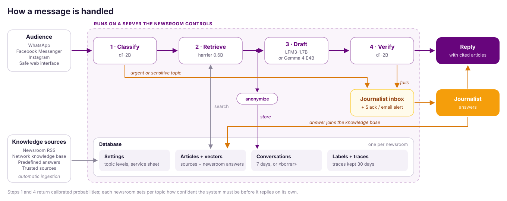
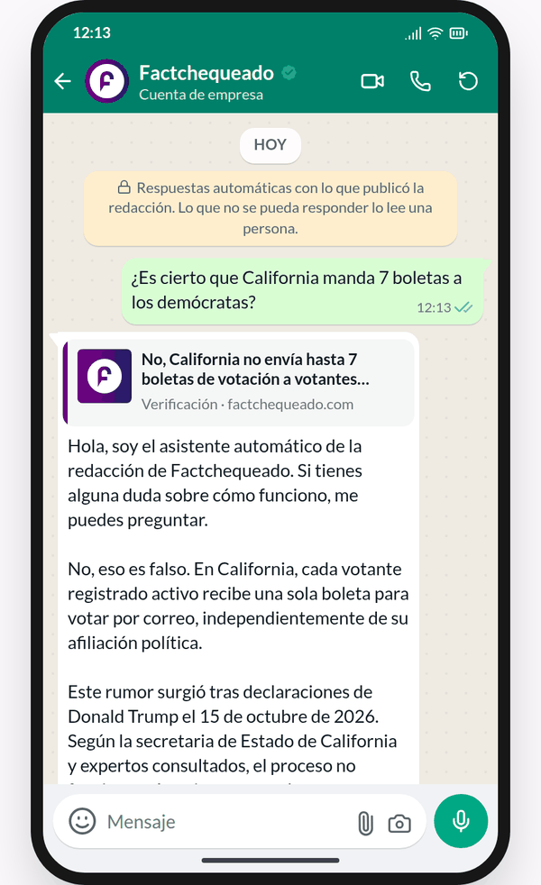
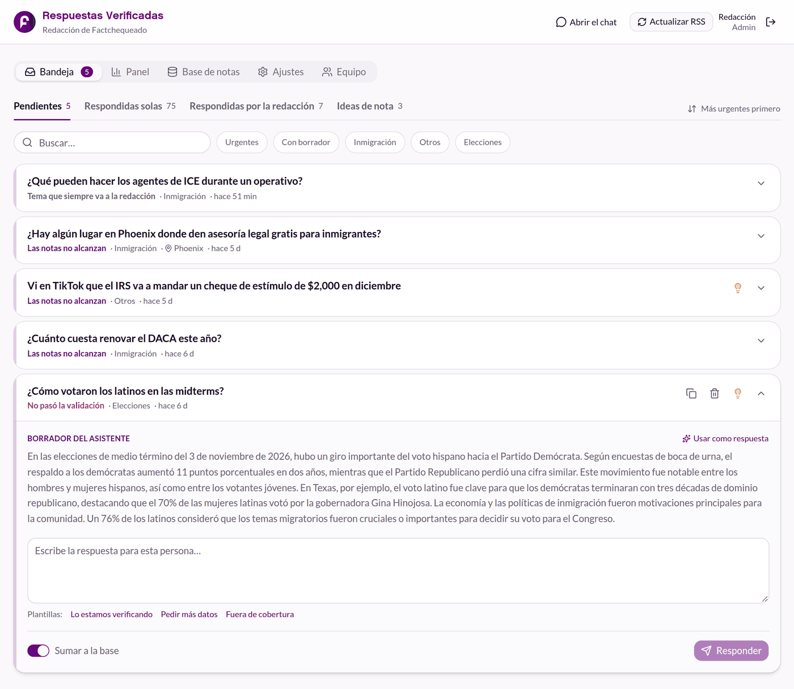

# Respuestas verificadas

La mayoría de los chatbots para medios pone a un modelo de lenguaje generalista a cargo y confía en que no se aparte de sus fuentes. Nuestra infraestructura integra al proceso las decisiones de validación y derivación, y se apoya en modelos chicos e independientes, cada uno con su tarea.

d1, de Liquid AI, es un modelo de decisión de 2B, diseñado específicamente para clasificación, enrutamiento y puntuación. Clasifica cada mensaje y revisa cada borrador contra las notas que cita, con una probabilidad calibrada para cada control. Así cada medio decide, tema por tema, cuánta confianza necesita el sistema para responder solo: puede dejar que el asistente conteste las preguntas de rutina sobre fechas de votación y que todas las de inmigración pasen por un periodista.

Un modelo generativo chico, de 4B, redacta las respuestas a partir de la base de conocimiento del medio y sus aliados. d1 y el modelo de búsqueda entran en una GPU de 4 GB y el generador en una de 8 GB, así que el sistema es barato de instalar y de mantener.

Es un prototipo que funciona, desarrollado por [Factchequeado](https://factchequeado.com) para medios en español que informan a comunidades latinas en Estados Unidos, a partir de lo que aprendimos con [ChatMigrante](https://factchequeado.com/press-releases/20250312/factchequeado-presenta-chatmigrante/). *English: [README.md](README.md).*



<p align="center">
  
  
</p>

*A la izquierda, el asistente responde un rumor por WhatsApp y cita la verificación. A la derecha, la bandeja de la redacción, con las preguntas que no respondió, el motivo y un borrador que no pasó la revisión de d1.*

## Cómo funciona

- [d1-2B](https://huggingface.co/LiquidAI/d1-2B) clasifica cada mensaje y revisa cada borrador. Detecta urgencias, temas sensibles y más. En nuestras pruebas, un modelo de lenguaje de 31B dio entre 95 y 100 % de confianza en todos los mensajes, mientras que los puntajes más bajos de d1 coincidieron con los casos realmente ambiguos. Eso nos permite calibrar mejor las derivaciones y ser más cuidadosos con las preguntas que respondemos automáticamente.
- [harrier](https://huggingface.co/microsoft/harrier-oss-v1-0.6b), un modelo de embeddings de 0,6B, busca en las notas del medio. El generador de 4B escribe la respuesta a partir de ellas.
- Cuando un periodista responde una pregunta derivada, la respuesta se suma a la base: el sistema aprende de la redacción sin reentrenar.
- Cada medio tiene su propia instalación y su base. Los datos personales se quitan antes de guardar, las conversaciones vencen a la semana y cualquiera puede borrar la suya escribiendo «borrar».

Funciona por chat web, WhatsApp, Messenger e Instagram. La página de la redacción tiene la bandeja, avisos por Slack y correo, un tablero de lo que pregunta la comunidad, la base de conocimiento y los ajustes.

## Para empezar

```bash
cd backend && python3 -m venv .venv && .venv/bin/pip install -r requirements.txt
cp .env.example .env                       # elegir el generador
.venv/bin/python -m app.ingesta            # cargar el RSS del medio
.venv/bin/python -m app.usuarios crear --email vos@medio.org --nombre "Vos" --rol admin
cd ../frontend && npm install && npm run build
cd .. && ./demo.sh                         # http://localhost:8000
```

Python 3.12, Node 20+ y una GPU NVIDIA con 4 GB de VRAM para los modelos de decisión, más 8 GB para correr el generador en local (también corre en CPU, más lento). El generador es cualquier servidor compatible con la API de OpenAI, local o en la nube.

Las guías están en inglés, en [docs/](docs/). El código, los prompts y los comentarios están en español.

## Próximos pasos

- Un set de evaluación para la calidad de las respuestas y las derivaciones.
- Infraestructura propia con GPU.
- Imágenes y notas de voz.
- Atender a varios medios desde una instalación compartida, con la configuración de privacidad adecuada.
- Inicio de sesión con OAuth.
- Backend en Django.

## Licencia

[Apache 2.0](LICENSE). Los modelos tienen sus propias licencias.
