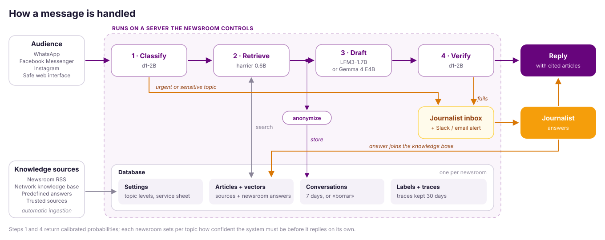
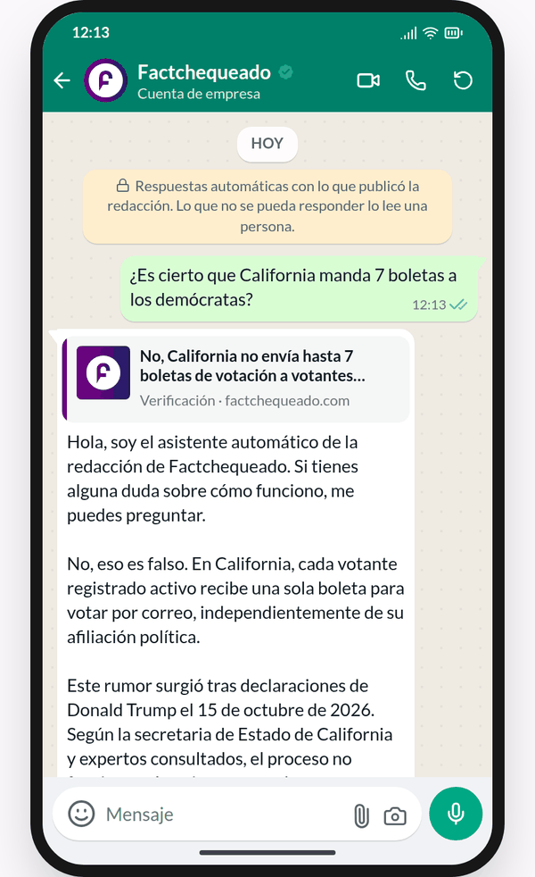
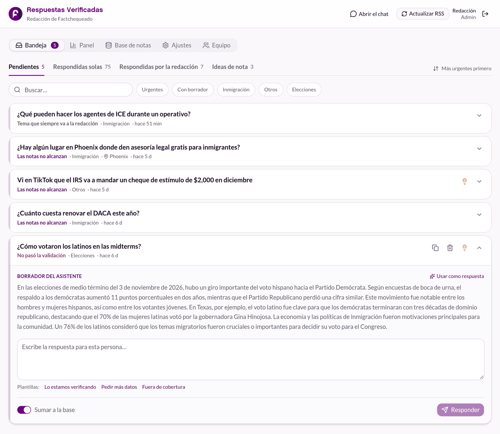

# Puente

Most newsroom chatbots put a general-purpose language model in charge and trust it to stay within its sources. Our infrastructure builds validation and escalation decisions into the process and relies on small, independent models, each with its own task.

Liquid AI's d1 is a 2B decision model, built specifically for classification, routing and scoring. It classifies each message and checks each draft against the articles it cites, with a calibrated probability for every check. That lets newsrooms decide, topic by topic, how confident the system must be before it answers on its own: a newsroom can let the assistant handle routine questions about voting dates and keep every immigration question in a journalist's hands.

A small 4B generative model drafts the responses from the knowledge base of the newsroom and its allies. d1 and the search model fit on a 4 GB GPU and the generator on an 8 GB one, so the system is cheap to set up and run.

This is a working prototype developed by [Factchequeado](https://factchequeado.com), built for Spanish-language newsrooms serving Latino communities in the United States and building on what we learned running [ChatMigrante](https://factchequeado.com/press-releases/20250312/factchequeado-presenta-chatmigrante/). *Español: [README.es.md](README.es.md).*



<p align="center">
  
  
</p>

*Left: the assistant answers a rumor on WhatsApp and cites the fact-check. Right: the journalist inbox, with the questions it didn't answer, why, and a draft that failed d1's check.*

## How it works

- [d1-2B](https://huggingface.co/LiquidAI/d1-2B) classifies every message and checks every draft. It detects urgency, sensitive topics, and more. In our tests, a 31B language model reported 95–100% confidence on every message, while d1's lowest scores matched the genuinely ambiguous ones. This lets us better calibrate escalation decisions and be safer about which questions we answer automatically.
- [harrier](https://huggingface.co/microsoft/harrier-oss-v1-0.6b), a 0.6B embedding model, searches the newsroom's articles. The 4B generator drafts the reply from them.
- When a journalist answers an escalated question, the answer joins the knowledge base, so the system learns from journalists without retraining.
- Each newsroom has its own installation and database. Personal data is stripped before storage, conversations expire after a week, and anyone can delete theirs by writing «borrar».

It works over web chat, WhatsApp, Messenger and Instagram. The newsroom page has the inbox, Slack and email alerts, a dashboard of what the community asks, the knowledge base and the settings.

## Quick start

```bash
cd backend && python3 -m venv .venv && .venv/bin/pip install -r requirements.txt
cp .env.example .env                       # choose the generator
.venv/bin/python -m app.ingesta            # load the newsroom's RSS feed
.venv/bin/python -m app.usuarios crear --email you@newsroom.org --nombre "You" --rol admin
cd ../frontend && npm install && npm run build
cd .. && ./demo.sh                         # http://localhost:8000
```

Python 3.12, Node 20+ and an NVIDIA GPU with 4 GB of VRAM for the decision models, plus 8 GB to run the generator locally (it also runs on CPU, slowly). The generator is any OpenAI-compatible server, local or hosted.

| Guide | |
|---|---|
| [setup.md](docs/setup.md) | Installation, generator choice, adapting it to a newsroom |
| [architecture.md](docs/architecture.md) | Pipeline, data model, design decisions |
| [channels.md](docs/channels.md) | WhatsApp, Messenger and Instagram |
| [notifications.md](docs/notifications.md) | Slack and email alerts |
| [newsroom-guide.md](docs/newsroom-guide.md) | Daily work for journalists |

Code, prompts and comments are in Spanish.

## Next steps

- An evaluation set for response quality and escalation decisions.
- Self-owned GPU infrastructure.
- Images and voice notes.
- Serving several newsrooms from one shared installation with proper privacy configurations.
- OAuth login.
- Django backend.

## License

[Apache 2.0](LICENSE). The models keep their own licenses.
