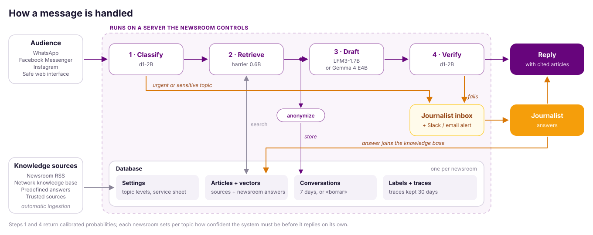

# Architecture

## The pipeline

Every message goes through `circuito.procesar` (`backend/app/circuito.py`):

1. **«borrar».** If the person asks to delete the conversation, it is deleted and nothing else runs.
2. **Classify (d1).** Each message is labeled as a question, urgent or spam, along with its topics and location. Urgent messages get the newsroom's fixed reply and go to the inbox.
3. **Topic level.** The newsroom's setting for the message's topics decides what happens next:
   - **redaccion**: the question goes straight to the inbox;
   - **exigente**: the checks below use higher thresholds;
   - **normal**: the usual thresholds apply.
4. **Read links.** For shared links, the server reads the title, author and post text with oEmbed and page metadata. It never runs scripts and never follows internal addresses.
5. **Search (harrier).** The server embeds the message alone, and together with the person's previous messages. It finds the closest chunks and returns the articles they belong to.
6. **Draft (generator).** The generator receives the service sheet as article 1, then five articles, the thread and the links. It returns JSON constrained by a schema: an action (answer, ask or escalate), an optional introduction for the first turn, the message, and the articles it cited.
7. **Check (d1).** Each part is checked separately:
   - the introduction, against the service sheet;
   - an answer that cites articles: "Is everything it says in these articles?" and "Does it answer the question?";
   - a message without citations: "Does it state facts?" It may not.
8. **Send or escalate.** If the checks pass, the reply is sent. If not, the question goes to the inbox with the draft, and the person gets the newsroom's fixed message. Escalations can alert the newsroom on Slack and by email ([notifications.md](notifications.md)).

A turn takes 1.5 to 5 seconds with a hosted generator and d1 on a 4 GB GPU.

## Why the decisions are made by a decision model

d1-2B (Liquid AI's LFM3 family) doesn't write text. It answers several typed questions in one pass (choices, yes/no, short text), each with a calibrated probability. Because the probabilities are meaningful, the newsroom can set thresholds and choose the level for each topic.

In our tests, a 31B language model reported 95–100% confidence on every classification, while d1's lowest scores matched the genuinely ambiguous messages. When d1 is unsure, the question goes to a person.

## Why there is no LLM framework

The pipeline is fixed and short: two d1 passes, two searches and one generator call. Each piece is a plain function:
- d1 runs through Transformers;
- harrier runs through sentence-transformers and sqlite-vec;
- the generator is one HTTP call to `/chat/completions`, with a JSON schema and a Pydantic model.

This keeps every prompt, threshold and decision readable in a few files. Changing the generator means changing a URL.

## Code map

| File | What it does |
|---|---|
| `app/circuito.py` | The pipeline, from message to reply |
| `app/clasificador.py` | d1: classification and checks |
| `app/busqueda.py` | Article-level search over chunks |
| `app/generador.py` | Prompt, JSON schema and call to the generator |
| `app/ajustes.py` | Newsroom settings: service sheet, fixed messages, topic levels |
| `app/conversaciones.py` | Conversations, expiry and «borrar» |
| `app/usuarios.py` | Users, passwords (scrypt) and sessions; `python -m app.usuarios` |
| `app/canales.py` | WhatsApp, Messenger and Instagram through Meta's webhook |
| `app/avisos.py` | Slack and email alerts when a question reaches the inbox |
| `app/lector.py` | Safe reading of shared links (oEmbed and page metadata) |
| `app/ingesta.py` | RSS ingestion, chunking and embeddings |
| `app/db.py` | SQLite schema |
| `app/main.py` | HTTP API |
| `frontend/src/components/chat` | Audience chat, as a web chat and a WhatsApp preview |
| `frontend/src/components/redaccion` | Inbox, dashboard, knowledge base, settings, team, sign-in |

## Data model

SQLite with sqlite-vec, one file per newsroom:

| Table | Contents | Retention |
|---|---|---|
| `notas`, `fragmentos`, `vec_fragmentos` | Articles, chunks and their vectors | Permanent |
| `conversaciones`, `turnos` | Conversation threads, without personal data | A week after the last message, or «borrar» |
| `canales` | Which channel and sender a conversation belongs to | Deleted with the conversation |
| `consultas` | One row per turn: labels and d1's scores. Text and thread are kept only if escalated | Labels are permanent; text is removed on «borrar» |
| `trazas` | Timings, raw generator output and d1's scores | 30 days, or «borrar» |
| `ajustes` | Newsroom settings | Permanent |
| `usuarios`, `sesiones` | Team members and sign-in sessions | Sessions expire after 14 days |

## What a multi-newsroom version would need

Today each installation serves one newsroom. Hosting several newsrooms in one installation, as shared infrastructure, would need:
- a `medio_id` on every table, or one database per newsroom;
- users that belong to a newsroom;
- per-newsroom RSS ingestion and channel tokens;
- a shared generator and d1 with request queuing.

None of this changes the pipeline.
